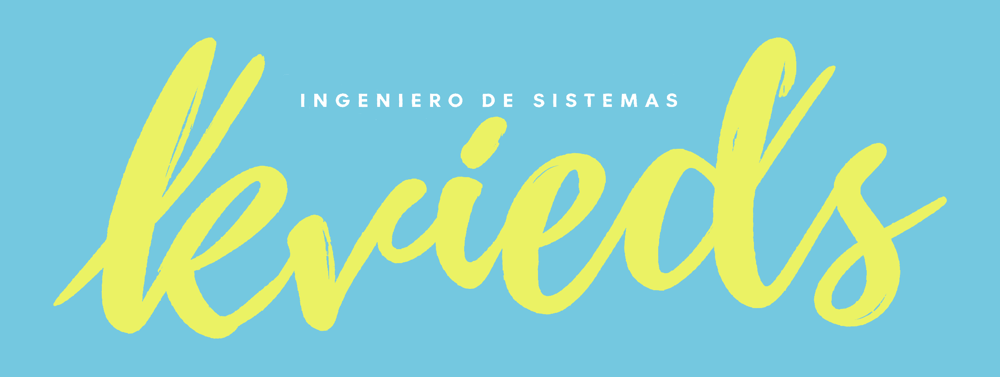

  <picture>
    <source media="(prefers-color-scheme: dark)" srcset="assets/kvieds-dark.png" />
    
  </picture>

  <strong>Construyo herramientas que convierten procesos complejos en experiencias claras, útiles y verificables.</strong> 
  Software · Automatización · Accesibilidad · Juegos de aprendizaje

  
  

---

## Sobre mí

Desarrollo soluciones en la intersección de **ingeniería de software, tecnología educativa, automatización y experiencia de usuario**. He trabajado en integraciones con Moodle, flujos de matrículas, análisis de datos, herramientas de accesibilidad y prototipos de aprendizaje basado en juegos.

Me interesa construir sistemas que permitan **automatizar, validar, medir y mejorar**: desde un proceso académico de gran volumen hasta una experiencia interactiva que enseña a tomar decisiones.

---

## Proyectos y desarrollos

### Type Matchup Coach · Aprendizaje basado en juegos

Aplicación web interactiva para **aprender y practicar la efectividad de los tipos Pokémon**: ventajas, resistencias, inmunidades, combinaciones de doble tipo y decisiones estratégicas de combate.

**Funciones del prototipo**

- Tabla y lógica de efectividad de **18 tipos**, con cálculo de enfrentamientos de tipo doble.
- **Siete modos de práctica:** ¿Qué le gana?, ¿Quién sobrevive?, ¿Cuánto daño?, Tipo doble, ¿Switch seguro?, Debilidad compartida y ¿Qué mando?
- Preguntas generadas de forma dinámica, con retroalimentación explicativa.
- Estadísticas de aciertos, errores, racha y precisión, guardadas localmente con `localStorage`.
- Interfaz responsive con vistas de **Consulta** y **Práctica**, navegación por modos y atajos de teclado.

  
  
  
  
  
  
  

Próximas exploraciones, aún no implementadas: versión PWA/offline, práctica espaciada y adaptación a Flipper Zero. Proyecto independiente de aprendizaje, sin afiliación con los titulares de Pokémon.

### Enrollment Control Center (ECC) · Automatización académica

Sistema de apoyo a la gestión de **matrículas masivas en Moodle** con un flujo de **carga → validación → revisión → aprobación → ejecución** y conciliación de resultados.

**Componentes trabajados:** importación y normalización de archivos, validación de usuarios y cursos, ejecución por servicios web, trazabilidad de operaciones, historial y reportes por programa, y detección de diferencias entre plataformas y registros.

  
  
  
  
  
  
  
  

### DUA Core + DUA Studio · Accesibilidad e investigación aplicada

Iniciativa de investigación aplicada en **Diseño Universal para el Aprendizaje (DUA)** y accesibilidad de experiencias educativas digitales.

**Componentes trabajados:** marco metodológico e instrumentos de diagnóstico, aplicación **DUA Studio** para apoyar la revisión de contenidos, componente de integración con **Moodle**, diseño de un panel de preferencias de accesibilidad y auditorías exploratorias de interfaz.

  
  
  
  
  
  
  
  

Proyecto en validación; no se presenta como producto certificado en conformidad ni como investigación concluida.

### Analítica y gestión de Moodle · Informes académicos

Consultas y automatizaciones para el seguimiento de **matrículas, accesos, actividad, progreso, calificaciones y finalización de cursos**, además de procesamiento de listados y controles de consistencia de datos.

  
  
  
  
  
  

### Gestión y trazabilidad administrativa · Diseño de producto

Diseño de un sistema para organizar **actas, compromisos, documentos, comunicaciones y seguimiento financiero**, con enfoque en evidencia, control y trazabilidad de decisiones.

  
  
  
  

### [Proyecto Jenkins](https://github.com/KVIEDS/proyecto-jenkins) · Integración continua

Ejercicio práctico de pipeline con conexión a GitHub, obtención del código y etapas de construcción, prueba y **simulación** de despliegue. La ejecución del pipeline se verificó correctamente.

  
  
  
  
  

---

## Laboratorio de aprendizaje

Además del desarrollo de software, he elaborado un **marco metodológico para el diseño de juegos educativos** con criterios de mecánicas, *core loop*, retroalimentación, evaluación, UX educativa y estructura de *Game Design Document (GDD)*. Lo utilizo para dar fundamento pedagógico a prototipos como Type Matchup Coach.

También exploro interfaces de interacción compacta y desarrollo portátil; estas líneas forman parte de una hoja de ruta, no de productos publicados.

---

## Tecnologías y herramientas

**Lenguajes, web e integraciones**

  
  
  
  
  
  
  

**Plataformas, datos y calidad**

  
  
  
  
  
  

**Accesibilidad y experiencia de usuario**

  
  
  
  

**Versionado y automatización**

  
  
  

---

Automatización · Accesibilidad · Experiencias de aprendizaje · Desarrollo de producto

