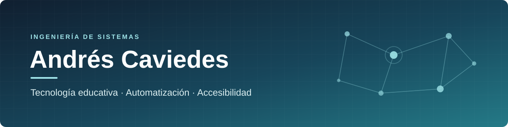

  

  <strong>Ingeniería de sistemas aplicada a procesos educativos y soluciones digitales.</strong> 
  Diseño herramientas que conectan plataformas, datos y personas para reducir tareas manuales y mejorar la trazabilidad de los procesos.

  
  

---

## Sobre mí

Trabajo en la **administración y evolución de plataformas Moodle**, el **desarrollo de soluciones de automatización académica** y la **investigación aplicada en accesibilidad digital**.

Mi enfoque combina desarrollo de software, integración mediante APIs, análisis de datos y diseño de procesos verificables. Me interesa que las herramientas no solo ejecuten tareas, sino que también permitan **validar resultados, detectar diferencias y mantener trazabilidad**.

| Línea de trabajo | Enfoque |
|---|---|
| **Automatización académica** | Matrículas masivas, validaciones, aprobaciones y conciliación de información en Moodle. |
| **Accesibilidad y aprendizaje** | Herramientas orientadas al Diseño Universal para el Aprendizaje (DUA) y al análisis de accesibilidad de contenidos. |
| **Analítica operativa** | Consultas SQL, informes de cursos y seguimiento de la actividad académica. |
| **Ingeniería de software** | Integraciones REST, interfaces de gestión y prácticas de integración continua. |

---

## Proyectos

### Enrollment Control Center (ECC)

Plataforma para gestionar **matrículas masivas en Moodle** mediante un flujo controlado de **carga, validación, revisión, aprobación y ejecución**.

Incluye identificación de usuarios y cursos, operaciones mediante servicios web de Moodle, historial de procesos, reportes y mecanismos de **conciliación entre los resultados de Moodle y los registros de gestión**.

  
  
  
  
  
  

### DUA Core y DUA Studio

Proyecto de **investigación aplicada y desarrollo tecnológico** para explorar cómo diagnosticar barreras de acceso, proponer alternativas y apoyar la adaptación de experiencias de aprendizaje digital.

- **DUA Studio** articula el inventario, el diagnóstico, la revisión humana y el seguimiento de contenidos.
- **DUA Core** organiza el marco metodológico y la integración propuesta con un componente de apoyo en Moodle.

El trabajo toma como referencia el **Diseño Universal para el Aprendizaje** y las **WCAG 2.2**, sin asumir una certificación de conformidad ni resultados de investigación aún no validados.

  
  
  
  
  

### Automatización, informes y gestión de Moodle

Consultas y herramientas de apoyo para la **gestión de cursos, el seguimiento de matrículas y la generación de informes**.

Incluye análisis de accesos, progreso, calificaciones y completitud, además del procesamiento de listados y la conciliación de datos académicos.

  
  
  
  
  

### Sistema de gestión y trazabilidad para propiedad horizontal

Organización y seguimiento de información administrativa: **actas, compromisos, comunicaciones, documentación y control financiero**.

Busca consolidar evidencia y facilitar la trazabilidad de decisiones y procesos de gestión.

  
  
  

### [Proyecto Jenkins](https://github.com/KVIEDS/proyecto-jenkins)

Ejercicio de **integración continua** mediante un pipeline de Jenkins para una aplicación en Python.

  
  
  

---

## Tecnologías y herramientas

**Desarrollo e integración**

  
  
  
  
  

**Plataformas, datos y automatización**

  
  
  
  
  

**Accesibilidad y experiencia de usuario**

  
  
  

**Control de versiones e integración continua**

  
  
  

---

  Me interesa desarrollar soluciones útiles, documentadas y verificables.

